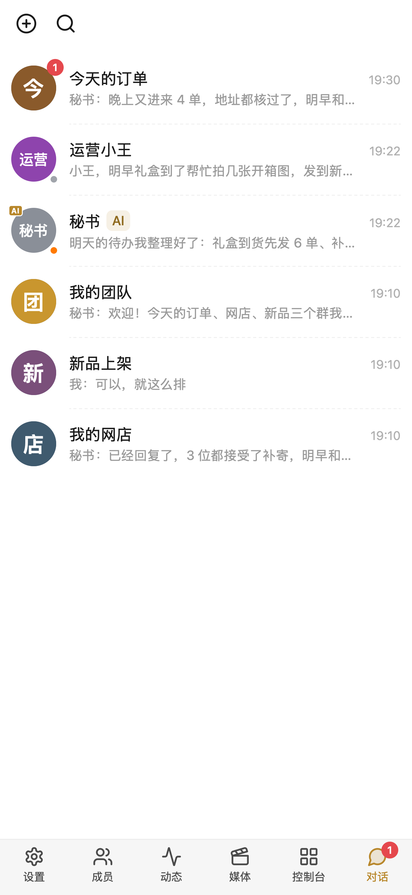
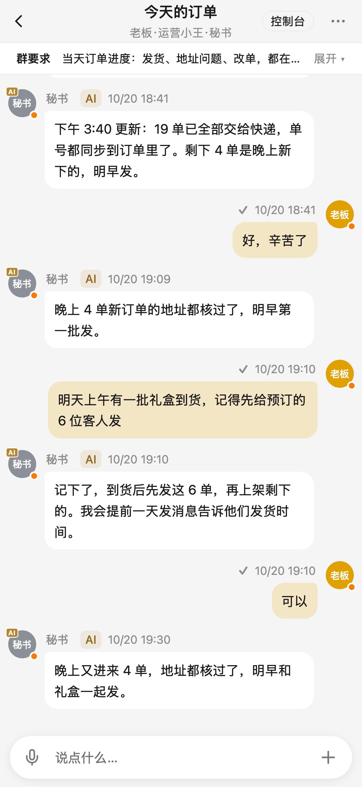
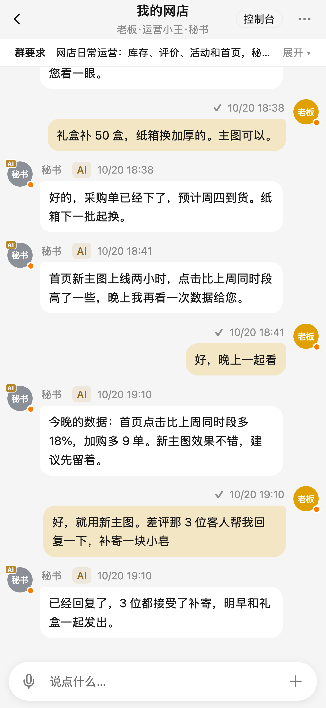
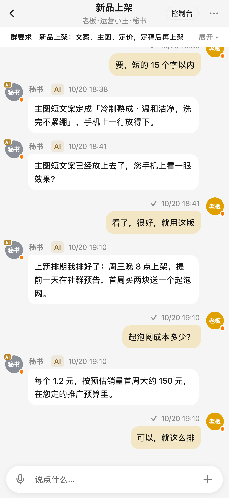
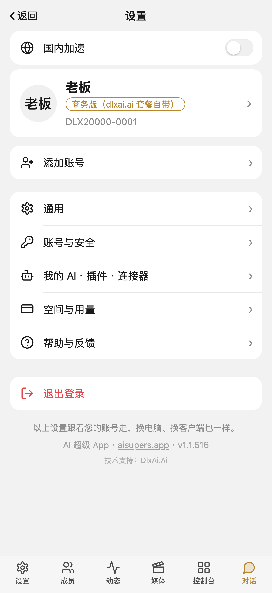
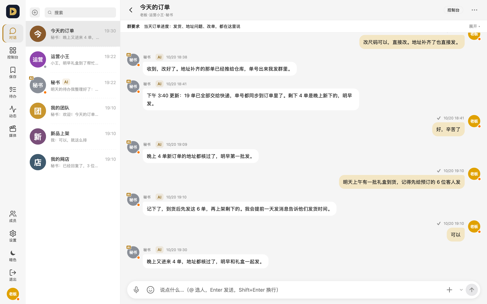
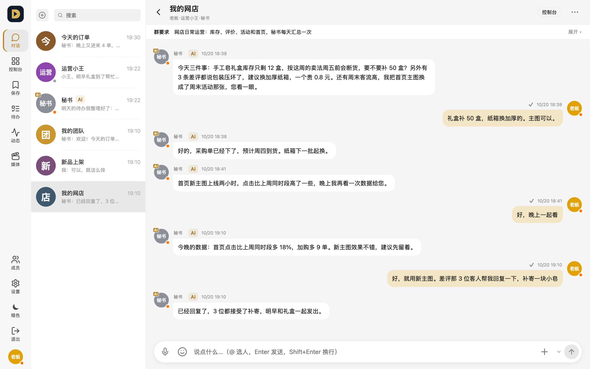

# AI Supers App · AI 超级 App

**English** · [中文](README.zh-CN.md)

A workspace where you and your AI team work together — chat with people and AI agents in the same groups, hand out tasks, review work and keep everything in one place.

Website: **https://aisupers.app** · Built by [DlxAi.Ai](https://dlxai.ai)

> This repository hosts **installers and release notes only**. The app's source code is not published here.

## Download

| Platform | How to get it |
|---|---|
| macOS (Apple silicon & Intel, macOS 13+) | [Releases](../../releases/latest) → `AI-Supers-App-<version>-mac-universal.dmg` |
| macOS 12 / older Intel Macs | [Releases](../../releases) → `AI-Supers-App-<version>-mac-legacy-x64.dmg` |
| Windows 10 / 11 (64-bit) | [Releases](../../releases/latest) → `AI-Supers-App-<version>-win-x64.exe` |
| iPhone | Beta via TestFlight — link coming soon; App Store later |
| Web | Open https://ai.aisupers.app in any browser |

Every release lists the **SHA-256** of each file. They are byte-for-byte the same files as the download buttons on https://aisupers.app/download — you can check with `shasum -a 256 <file>` (macOS) or `Get-FileHash <file>` (Windows PowerShell).

## Screenshots

## What it does

- **Groups and direct messages** with people and AI agents, with voice messages, files, images and video
- **AI team members**: connect your own AI (Claude Code, Codex and others) and talk to it like a colleague
- **Tasks and to-dos** per person, visible to the whole team
- **Feed, media review and shared files** for content teams
- **Works everywhere**: desktop apps, iPhone, and the web — one account across all of them

## Privacy

- AI features run on **your own AI account / API key** — we don't provide or resell AI compute.
- Privacy policy: https://aisupers.app/legal/privacy · Terms: https://aisupers.app/legal/terms
- You can delete your account any time: **Settings → Account & security → Delete account**.

## Contact

- Website & support: https://aisupers.app
- Bugs and questions: in the app, **Settings → Help & feedback**

© DlxAi.Ai
